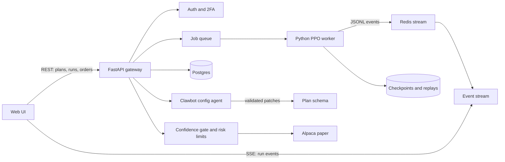

# PathRise backend

The UI in `ui-concepts/` talks to one gateway. This preview ships a mock of that gateway in `ui-concepts/api.js`. Pointing the same calls at FastAPI is the only switch required to leave the mock. Set `window.PR_API` before `api.js` loads and the mock stops intercepting `/api/`.

Nothing here places live orders. Paper routing stays off until Release passes and a person approves it in Oversight.

## Pieces

- **Gateway.** FastAPI. Sessions, TOTP 2FA, and the REST and SSE routes below. It never returns broker secrets to the browser.
- **Postgres.** Users, plans, plan versions, runs, orders, and the audit trail.
- **Queue.** One training job per run. Pause, stop, and branch are signals to that job.
- **Worker.** The existing Python PPO stack (Stable-Baselines3 policy with a temporal convolutional network). It reads a frozen plan through `config.py` and `ppo/utils/dynamic_config.py`.
- **Redis.** The worker appends JSON events. The gateway tails them for browsers, including a phone that reconnects.
- **Object store.** Checkpoints and the gym replay used by the Arena.
- **Clawbot.** An LLM with the tools below. It proposes JSON patches. It does not apply them.
- **Gates.** Regime controller, confidence gate, and risk limits run before any paper order.

## Plan lifecycle

The plan document is `ui-concepts/fixtures/plan.schema.json`. The form, Clawbot, and the worker all use it.

- A draft is mutable and versioned (`Save version` in Build a bot).
- `POST /api/runs` snapshots the plan. That snapshot is immutable.
- The worker refuses values outside the schema. Cautious style also locks the position cap at 8%.
- Credits are metered per step on Standard and Deep runs. Quick is free.

## HTTP

| Method | Path | Behavior |
| --- | --- | --- |
| GET | `/api/health` | Gateway and paper-broker reachability. |
| GET | `/api/plans/current` | The user's draft plan. |
| PUT | `/api/plans/current` | Replace the draft after schema validation. |
| POST | `/api/plans/propose` | Body `{ "text": "..." }`. Returns a diff or a refusal. Does not write. |
| GET | `/api/plans/estimate` | Credits, steps, and minutes for the draft. |
| POST | `/api/runs` | Enqueue a run from the current snapshot. Returns `{ "id", "status": "queued" }`. |
| GET | `/api/runs/{id}` | Status, step, and best checkpoint. |
| POST | `/api/runs/{id}/pause` | Signal the worker. |
| POST | `/api/runs/{id}/stop` | Stop and keep the best checkpoint. |
| POST | `/api/runs/{id}/branch` | Open a new draft warm-started from a checkpoint. |
| GET | `/api/runs/{id}/events` | Server-sent events. |
| GET | `/api/report` | Latest exam card. |
| GET | `/api/audit` | Plan and account changes. |

## Event stream

`GET /api/runs/{id}/events` is SSE. Each event has an id. A reconnecting client sends `Last-Event-ID` and the gateway replays from Redis.

Event types already used by the Arena fixture:

- `run.started`
- `stage.changed` — data, mentor, practice, exam, report
- `rollout.metrics` — `ep_rew_mean`, `ep_len`, `approx_kl`, `entropy`, `value_loss`, learning rate, action mix
- `eval.result` — deterministic numbers are the headline; stochastic numbers are a diagnostic
- `coach.event` — plain-language note, including the entropy boost at step 12,288
- `checkpoint.saved`
- `run.finished`
- `run.failed`

The UI treats a run as healthy when reward is rising, `approx_kl` stays small, and entropy does not collapse. The coach says that in a sentence. Pro mode shows the raw series.

## Clawbot tools

The model may call only these. The mock in `plan.js` implements the same decisions without an LLM so the preview is deterministic.

| Tool | Effect |
| --- | --- |
| `plan.get` | Read the draft. |
| `plan.propose_patch` | Return a JSON patch and a diff. |
| `plan.apply_patch` | Write the patch. The UI calls this only after the user presses Apply. |
| `plan.explain_field` | Plain-language limits for one field. |
| `plan.estimate` | Credits, steps, minutes. |
| `plan.preset` | cautious, balanced, or bold. |
| `universe.suggest` | A name list inside the 30-ticker universe. |

Slash commands in the composer (`/set cap 8`, `/preset cautious`, `/explain cap`, `/estimate`) call the same functions.

Refusals:

- Out-of-range numbers are clamped and the reason is shown. The cap cannot exceed 15%.
- Requests to go live, place an order, or change a broker key are refused. Those stay on Oversight, Release, and Broker.

Every Apply is an audit row: who, when, field, old value, new value.

## Trading path

After a checkpoint is promoted to paper:

1. The regime controller labels the bar (`low_vol`, `high_vol`, `trend`, `mean_revert`).
2. The policy emits an action and a confidence.
3. The gate drops weak signals. High confidence is above 0.25, medium above 0.10, and a low reading waits out a cooldown.
4. Risk limits apply: position cap (default 15%, 8% when cautious), trailing stop 8%, hard stop near 10%, session halt 25%.
5. Surviving orders go to Alpaca paper. Live routing is not built. Release shows the five gates; two of them are still open in the sample data.

SHAP values for a decision are stored with the order. The explainer reads them later instead of recomputing in the browser.

## Security

- Session cookie plus TOTP. The preview login accepts any password so the desk can be opened on a phone.
- Broker keys are scoped to paper and stored encrypted. They are not in page source.
- One user's plans, runs, and orders are not readable by another.
- Chat is rate-limited.
- The browser holds the draft plan and a read token at most. It does not hold a trading secret.

## What the preview actually runs

`ui-concepts/api.js` answers the routes above from `plan.js` and replays `fixtures/quick-train.jsonl` over a fake `EventSource`. The Arena still plays that file directly so scrubbing does not depend on the stream. Both shapes are the same events.
